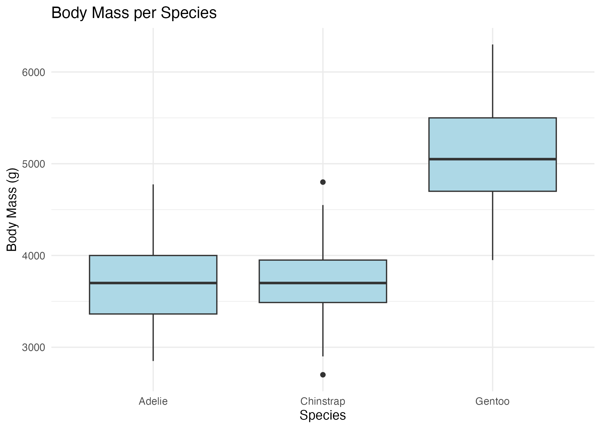
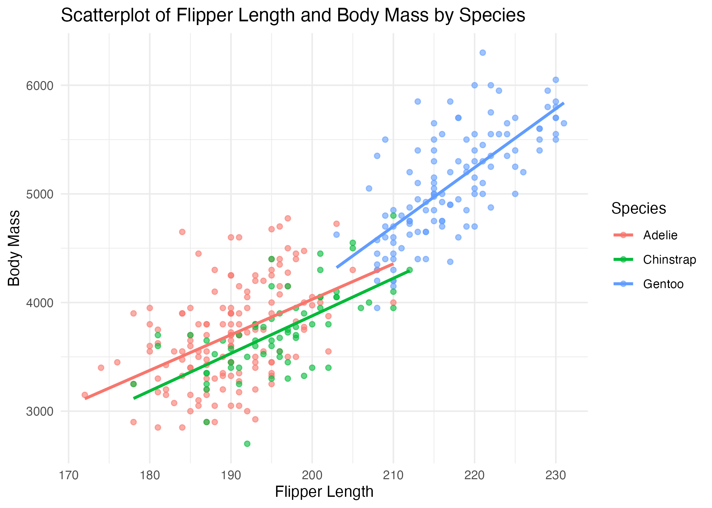

```{r}
library(tidyverse)
library(janitor)
library(skimr)
library(broom)
library(gt)
library(scales)
library(here)

source(here("R", "01_clean_data.R"))
source(here("R", "02_eda_functions.R"))
source(here("R", "03_model_functions.R"))
source(here("R", "04_plot_functions.R"))
```

## Introduction

This is a R project using the PalmerPenguins dataset from Github. This project will analyze penguin species, body measurements, along with relationships among variables. The work is organized using reusable scripts. Included in the project is a Shiny App, EDA, a regression model, visualizations, cleaning of the data,a readme file and a raw and processed version of the dataset.

## Analytical Question

The purpose of this analysis of the PalmerPenguins dataset is to answer: **How can body measurements and location information help us understand differences among penguin species, and how can we communicate these results in a professional, reproducible R portfolio project?**

## Dataset Description

The data in this dataset contains collected information on penguins observed in Antarctica. Originally there are 300 observations and 8 variables. Variables included are: species, island, bill_length_mm, bill_depth_mm, flipper_length_mm, body_mass_g, sex, and year.

## Structure

Week8_Industry_R_Portfolio/ ├── README.md ├── industry_r_workflow.qmd ├── renv.lock ├── renv/ │ └── activate.R ├── data/ │ ├── raw/ │ │ └── insurance.csv │ └── processed/ ├── R/ │ ├── 01_clean_data.R │ ├── 02_eda_functions.R │ ├── 03_model_functions.R │ └── 04_plot_functions.R ├── output/ │ ├── figures/ │ └── tables/ ├── app/ │ └── app.R └── automation/ └── render_report.R

## Packages

- **tidyverse** — data manipulation, visualization, and analysis
- **palmerpenguins** — provides the Palmer Penguins dataset
- **janitor** — cleans column names
- **skimr** — provides summaries of datasets
- **broom** — converts model results into tidy data frames
- **here** — creates file paths within the project
- **gt** — creates formatted tables
- **scales** — formats numbers, percentages, and other values
- **DBI** — provides an interface for working with databases
- **RSQLite** — connects R to SQLite databases
- **dbplyr** — allows dplyr code to work with databases
- **shiny** — creates interactive web applications
- **DT** — provide R interface to JS data tables
- **styler** — formats R code
- **lintr** — checks R code for style problems
- **renv::init( )** — starts using renv in current project
- **renv::snapshot( )** — saves package environment
- **renv::restore( )** — allows installation of pack versions on another computer

```{r}
#| eval: false

install.packages(c(
  "tidyverse",
  "palmerpenguins",
  "janitor",
  "skimr",
  "broom",
  "here",
  "gt",
  "scales",
  "DBI",
  "RSQLite",
  "dbplyr",
  "shiny",
  "DT",
  "styler",
  "lintr",
  "quarto"
))
```

## Data Cleaning

To make sure the data was prepped for analysis, some data cleaning was performed. Steps taken were:

1.  cleaned column names

2.  removed rows with missing values

3.  converted variable data types

## EDA Summary Tables

```{r}
summarize_missing_values(penguins)
```

```{r}
summarize_average_bodymass(penguins_clean)
```

```{r}
summarize_flipper_length(penguins_clean) 
```

```{r}
summarize_island_count(penguins_clean)
```

```{r}
summarize_numeric_var(penguins_clean)
```

## Visualizations

```{r}

```

```{r}

```

```{r}

```

## Regression Model

The regression model was used to predict penguin body mass based on flipper length, bill length, bill depth, species, and sex.

```{r}
mass_model <- fit_bodymass_lm(penguins_clean)

tidy_model_results(mass_model)

model_performance(mass_model)
```

The regression model explained **87.5%** of the variation in penguin body mass (R² = 0.875; adjusted R² = 0.873). Sex, species, and physical measurements were significant predictors of body mass. Male penguins were estimated to weigh 390 g more than females, while Gentoo penguins were estimated to weigh 1,015 g more than the reference species. Chinstrap penguins were estimated to weigh 251 g less than the reference species. Flipper length had a positive relationship with body mass, with each additional millimeter associated with approximately 16 g greater body mass. Bill depth and bill length were also positively associated with body mass.

## Limitations

The penguin dataset is relatively small and represents only a limited number of species, islands, and physical characteristics, so the findings may not generalize to all penguin populations. Second, missing observations were removed during data cleaning, which reduced the amount of data available for analysis. The model also does not include other factors that could influence body mass. 

## Database Workflow

CSV files is typically loaded into R before analysis. A database table, can be queried directly using tools such as dbplyr. This allows filtering, grouping, selecting, and summarizing data without loading the entire table into R. Databases are also useful for managing larger datasets and multiple tables, while CSV files are simpler and easier to share or view.

## Automation Discussion

This script could be scheduled using Windows Task Scheduler, cron, GitHub Actions, Posit Connect, or other internal workflow tools. Scheduling the script would allow reports to be generated automatically on a recurring basis, which is useful for analysts who regularly produce weekly or monthly reports.

## Coding Style and Quality 

Readable code is important in professional R programming because it makes projects easier to understand, maintain, troubleshoot, and collaborate on. Clear object names, consistent formatting, meaningful function names, and
helpful comments allow other analysts to understand the purpose of the code and make future updates more efficiently.

## Conclusion
This project demonstrated a complete data analytics workflow using the Palmer Penguins dataset. The data was cleaned and transformed before being used for exploratory data analysis, visualization, regression modeling, and database analysis. The regression model showed that physical characteristics such as flipper length, bill measurements, species, and sex were useful for explaining differences in penguin body mass, with the model explaining approximately 87.5% of the variation in body mass.
